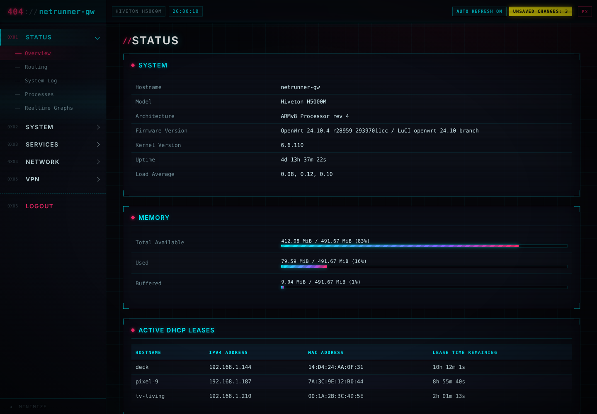
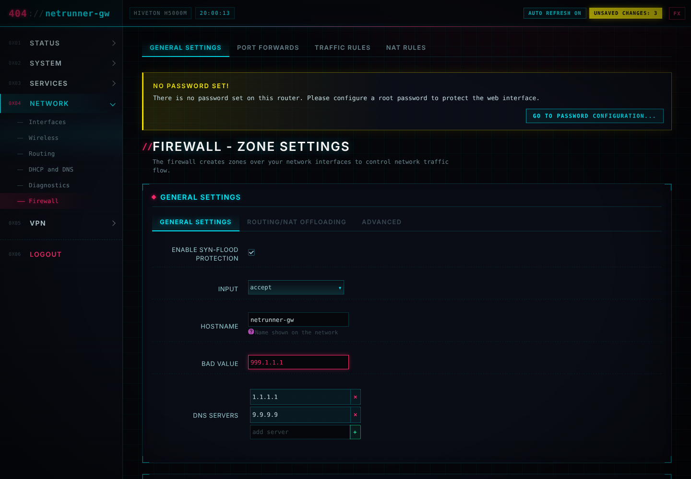
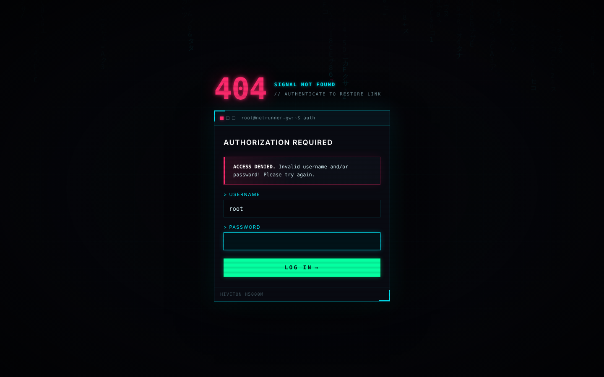
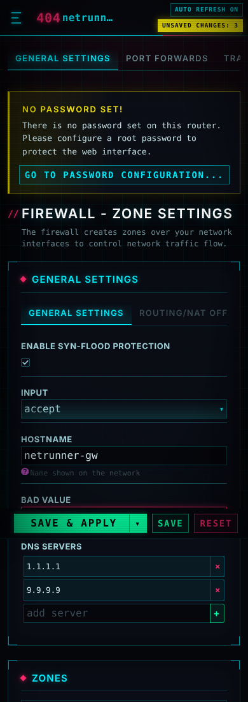

# 404 MODE

**Киберпанк-тема для LuCI / OpenWrt 24.10+** — неон, HUD-рамки, CRT-сканлайны, глитч и цифровой дождь на экране входа.

`SIGNAL NOT FOUND // AUTHENTICATE TO RESTORE LINK`



| Настройки | Вход | Мобильная |
|---|---|---|
|  |  |  |

## Что внутри

- **Шаблоны на ucode** (`header.ut` / `footer.ut` / `sysauth.ut`) — нативно для LuCI 24.10, без Lua-совместимости.
- **Боковое меню** с hex-индексами (`0x01 STATUS`…), аккордеон категорий, свёрнутый «мини» режим (запоминается).
- **HUD-шапка**: `404://hostname`, модель роутера, часы, индикаторы LuCI (автообновление, несохранённые изменения).
- **Компоненты LuCI** — таблицы, дропдауны, dynlist, вкладки, модалки, прогресс-бары, алерты, бейджи зон — все перекрашены в неон.
- **Экран входа** — «терминал доступа» с цифровым дождём на canvas.
- **Кнопка FX** в шапке — выключает сканлайны/глитч/анимации (для слабых устройств, сохраняется в браузере). `prefers-reduced-motion` учитывается автоматически.
- **Адаптив**: на телефоне меню — выезжающий drawer, таблицы — карточки.
- Без внешних шрифтов и CDN: работает на роутере без интернета.

## Установка

### Быстро (без сборки)

Прямо на роутере, OpenWrt 24.10:

```sh
uclient-fetch -qO /tmp/404.sh https://raw.githubusercontent.com/dontbass/404-Mode/main/install.sh && sh /tmp/404.sh
```

Удалить и вернуть bootstrap:

```sh
sh /tmp/404.sh --remove
```

### Пакетом (.ipk)

Готовый `luci-theme-404mode_*_all.ipk` собирается GitHub Actions — забрать в **Releases** (для тегов `v*`) или в артефактах workflow.

```sh
opkg install /tmp/luci-theme-404mode_*_all.ipk
```

Пакет сам регистрирует тему и делает её активной. Переключение: **System → System → Language and Style**.

### Сборка в своём buildroot / SDK

```sh
git clone https://github.com/dontbass/404-Mode.git package/404-Mode
make menuconfig   # LuCI → Themes → luci-theme-404mode
make package/404-Mode/luci-theme-404mode/compile V=s
```

## Структура

```
luci-theme-404mode/
├── Makefile
├── htdocs/luci-static/
│   ├── 404mode/
│   │   ├── cascade.css      # база компонентов + слой 404 MODE (палитра в :root)
│   │   ├── mobile.css       # ≤ 854px
│   │   ├── logo.svg / logo_48.png
│   └── resources/menu-404mode.js   # сайдбар, вкладки, drawer, FX, часы
├── ucode/template/themes/404mode/
│   ├── header.ut
│   ├── footer.ut
│   └── sysauth.ut           # экран входа
└── root/etc/uci-defaults/30_luci-theme-404mode
```

## Палитра

| Токен | Цвет | Где |
|---|---|---|
| `--n-cyan` | `#00f0ff` | основной акцент, ссылки, рамки |
| `--n-magenta` | `#ff2a6d` | активные пункты, ошибки, удаление |
| `--n-green` | `#05ffa1` | сохранить / применить |
| `--n-yellow` | `#fcee0a` | предупреждения, несохранённые изменения |
| `--n-void` | `#05060a` | фон |

Перекрасить тему — поменять токены в блоке `404 MODE LAYER → :root` в `cascade.css`.

## Лицензия

Apache-2.0. Базовые стили компонентов основаны на `luci-theme-bootstrap` (The LuCI Team, Apache-2.0).
